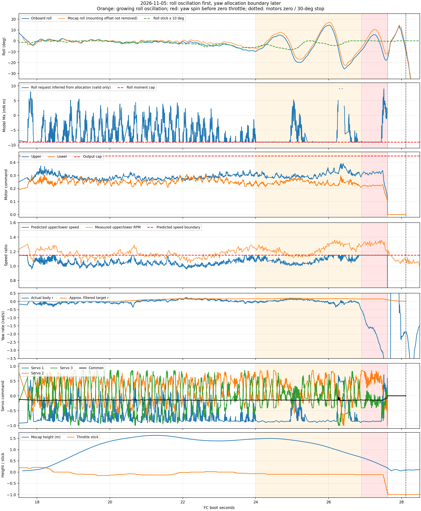

# 2026-11-05 失控诊断：roll 力矩饱和振荡，随后 yaw 分配受限

源日志：`log/26.11.5/log_0_UnknownDate.ulg`。下文时间均为飞控上电后秒数。只新增离线分析，没有修改飞控参数、控制器或固件。

## 结论与证据等级

这次先出现 **roll 闭环大幅振荡**，之后才出现 **yaw 方向上的分配权限不足**，最终降油门、近地翻倒并触发 30°保护。不是上次那种“下桨一直加速到输出上限”的过程，也不是保护先停电机导致最初失控。

确定的直接事实是：

1. 23–25 s，roll 模型力矩请求长期卡在 −0.009 N·m，随后真实 roll 振幅迅速增大；动捕与两枚陀螺支持真实运动。
2. 当前代码只对 yaw 积分做了有界/方向抗饱和，roll/pitch 的 ±0.009 N·m 力矩裁剪没有进入各自的抗积分饱和逻辑。长期力矩限幅时仍允许 roll/pitch 积分累积，是明确的控制逻辑缺口。近似回放支持 roll 积分偏置持续增大，但日志未直接记录积分，不能把回放值当成真实内部 trace。
3. 约 27 s，上/下桨**预测转速比**持续顶住 1.15 边界，正 yaw 请求无法实现，实际快速负向旋转。该分配边界确实限制了后段纠偏能力；两路电机输出都远未到 0.45。
4. 固定负格栅共模、暂定下桨反扭矩系数和共享转速曲线没有经过实机联合辨识。实际工作点与候选基础配平相差明显，原先简化 yaw/垂向模型通过不能代表 roll/pitch 稳定或真实 yaw 权限足够。

不能仅凭这条闭环日志唯一证明共模大小、机械效能、振动、相位滞后中哪一项是初始扰动的唯一来源。可以明确的是：这版在受限工况下的姿态控制和联合分配没有保持稳定，不应继续当作已验证稳定的配置使用。

## 飞行与失控时间线

| 时间 | 观察 |
|---|---|
| 14.600 s | 油门激活，控制器 reset；之后开始升速。 |
| 18–22 s | 已起飞。动捕高度升至约 1.6 m，roll 仍大致稳定，但已有持续负 roll 力矩偏置；yaw 曾持续负向漂移，之后飞手增加正 yaw 杆量。 |
| 23–24 s | roll 力矩下限占约 69% 有效记录样本；动捕 roll 约 −7.1°至 −0.7°。 |
| 24–25 s | roll 力矩下限占约 **93%** 有效记录样本；动捕 roll 约 −7.2°至 +8.0°，振荡开始明显增长。 |
| 25–26 s | 动捕 roll 扩大到约 **−16.9°至 +16.8°**，高度开始下降。此阶段尚没有持续的 yaw 转速比饱和。 |
| 26–27 s | 动捕 roll 约 −22.6°至 +17.0°；yaw 的上/下桨预测转速比边界占约 50%记录样本。 |
| **26.992 s** | 实际 yaw 角速度首次超过 −1 rad/s，此时飞手尚未切零油门。 |
| **27–27.5 s** | 预测上/下桨转速比持续在 **1.15**，实际 r 平均约 **−2.02 rad/s**，而飞手仍有正 yaw 指令。 |
| 27.606 s | 油门杆降至 −0.916。 |
| **27.616 s** | 两路电机软件命令归零。 |
| **28.1187 s** | pitch 约 +30°，独立姿态保护触发；约 28.125 s disarm。这发生在最初振荡、急剧偏航和切油门之后。 |

动捕在 17.5 s 前有一段旧帧，不能用于判断该阶段真实姿态；18–29 s 相关窗口 pose_fresh=100%。对应地面站会话是 `flight_20261105T030533_568Z_aircraft-01_2`，用其 message 19 飞控启动时间及机载四元数核对，与本 ULog 匹配。坐标/刚体安装外参没有重标定，因此比较的是运动趋势和幅度，不把动捕绝对欧拉角与机载值逐度等同。

## roll 为什么值得优先处理

在没有格栅共模退让且目标推力低于悬停标度的区间，当前分配满足：

`common = mean(servo_1, servo_2, servo_3) = -0.16 * servo_scale`

`servo_1 - common = 72.0721436 * Mx / servo_scale`

因此可从实际输出反算模型域的 roll 请求：

`Mx = (servo_1-common) * (-common/0.16) / 72.0721436`。

按这个关系，23–24 s 约 69%、24–25 s 约 93%的有效记录样本都在 −0.009 N·m 下限。这里的 N·m 是**模型请求值，不是实测气动力矩**。在这些区间三舵机并没有长期贴住 ±1 端点，所以最初问题不能简单归结为“共模把全部舵机行程吃光”。已有请求力矩裁剪和实际纠偏不足，是更直接的证据。

源码 `LqiCoaxialCollectiveCore.hpp` 先把三轴 `desired_moment` 裁到 `maximum_moment`，随后只用舵机原始幅度、旧路径电机饱和或新路径 yaw 分配残差处理积分。新 profile 下 roll/pitch 积分仅在舵机原始向量饱和时冻结，没有检查各自的力矩裁剪，也没有各自的积分上限。yaw 分配受限时原先的全轴冻结又被取消，因而不能依赖 yaw 限制替 roll/pitch 抑制积分累积。

在长期目标跟踪不足时，roll 积分会形成较大固定偏置。姿态或杆量改变后，这个偏置可能继续把输出压在同一侧，抵消本应制动/反向的 P、D 作用，引起恢复延迟和振荡放大。

`replay.py` 使用现有 C++参考适配器和核心，以 2 ms 时间步输入插值后的实测姿态、角速度、加速度和遥控量，得到 roll 积分偏置增长的趋势；24–26 s 的估计积分力矩绝对值可超过 0.009 N·m 请求上限。但回放存在传感器抽样、日志丢帧、实际调度不确定，舵机输出 RMSE 约 0.05–0.15，**不能视为精确内部状态还原，更不能据此宣称积分是唯一根因**。力矩限幅未纳入抗饱和则是直接可核查的源码事实。

此外，yaw 参考角仍由目标速率积分，而实际 yaw 速率跟踪不足，参考航向与实际航向会分离。当前 roll/pitch 四元数误差仍依赖该参考航向，存在进一步耦合姿态纠偏的风险，需要在修正时一起检查；日志没有目标四元数 trace，不能给出准确的实时航向误差数值。

## yaw 为什么仍会失去权限

这次配平状态与原来不同：18–22 s 典型上/下桨输出已接近 0.28/0.25，共模约 −0.14，而不是基础点 0.276/0.350。26–27 s 上/下桨实测 RPM 比中位数约 **1.30**；27–27.5 s 约 **1.32**。

同时，从实际电机输出代回当前命令—转速表，27–27.5 s 的**预测比值恰好停在 1.15**。这与新 profile 的边界行为相符，说明并非控制器没有要求纠偏，而是其允许的差速分配已经用完。

固定负共模始终提供一个负 yaw 偏置。当实际闭环需要更多正 yaw 力矩时，控制器提高上桨相对下桨的作用，却受到 1.15 边界限制。该共模只会因 roll/pitch 行程不足而退让，没有因为“yaw 已顶边且负共模妨碍正向纠偏”而主动回零。因此在这种工况下，保持转速接近、保持固定负共模与实现正向 yaw 纠偏不能同时满足。

这个配置中 1.15 本来就是模型稳态转速约束，不是 ESC 实测闭环。实测比值达到 1.30–1.32，进一步说明复用上桨曲线、按系数比 0.7 设计的联合配平没有充分描述实机。不能直接把“格栅共模 −0.16”视为正确的实机 yaw 配平，更不能认定归一化 −0.16 就一定对应实际格栅角 −3.2°。

ULog 的 `NN_LQI_MODEL=2`、负共模及精确的 1.15 模型边界与候选输出行为高度一致。不过日志没有 payload checksum，单凭相同 git hash 无法逐字节认证刷入镜像等于归档候选。

## 振动与日志丢帧

- 传感器选择为 BMI088 accel/gyro，设备 ID 分别为 6946834/6684690。BMI270 的 `Accel 1 clipping` 告警不能直接等同于主估计器加速度源削顶。
- 原始加速度振动很强；18–22 s BMI088 xyz 标准差约 37/16/22 m/s²，BMI270 约 75/33/47 m/s²。振动和滤波/执行器动态可能恶化闭环，需要处理。
- 但前一天稳定飞行也有较大的 IMU 振动指标，故不能用本次“有振动”唯一解释失控。23–27.5 s 两路 gyro 低于 8 Hz 的 roll/pitch/yaw 相关系数约 0.91/0.89/0.996，动捕也看到相同的大幅振荡：不是一枚陀螺独自报出假翻转。
- 全日志有 71 次 dropout，共约 4.945 s；失控窗口若干 ULog topic 有约 70–130 ms 的空洞。地面站独立遥测在 24–27 s 记录的电机输出时间戳年龄最大约 2.9 ms，姿态样本年龄约 5 ms，CPU load 约 0.51–0.55，没有证据把这些 ULog 空洞直接解释为控制器停算同样长时间。低频遥测仍不能排除每一次短暂停顿。
- ESC 记录未报告 failure/errorcount，失控前没有单路 RPM 突然归零；这些不能证明桨叶、舵机、供电和气动力完全正常。

## 下一步应先改什么

1. **先补齐 roll/pitch 对实际力矩限幅的按轴抗饱和与有界积分，并处理起飞/接地时积分。**不要只通过加大力矩上限或增益掩盖长期饱和。
2. **把固定格栅共模改成有界、可退让的 yaw 配平分量。**当它妨碍所需方向的 yaw 纠偏、且电机差速已经到边界时，应允许其向零回退，不能只等舵机行程耗尽才退让。
3. 用实测 ESC RPM 和台架力矩/偏航响应联合核对上下桨模型、格栅共模正负方向、幅度及 roll/pitch 寄生耦合。不能继续把 0.7、−0.16 和共享转速曲线当作已辨识参数。
4. 补录三轴未裁剪/已裁剪力矩、积分、实际采用的共模、差速缩放、目标四元数、模型 checksum；在完整姿态/执行器动态下验证，再评估新配平。

上一版仅完成了边界检查和简化 yaw/垂向验证，没有覆盖本次暴露的 roll/pitch 积分与真实联合效能问题。这是验证范围不足，不能把测试通过等同于实机稳定。

文件：`parse_ulog.py`、`analyze.py`、`replay.py`；结果为 `metrics.json`、`timeline.csv`、`replay_metrics.json` 和 `crash_timeline.png`。
