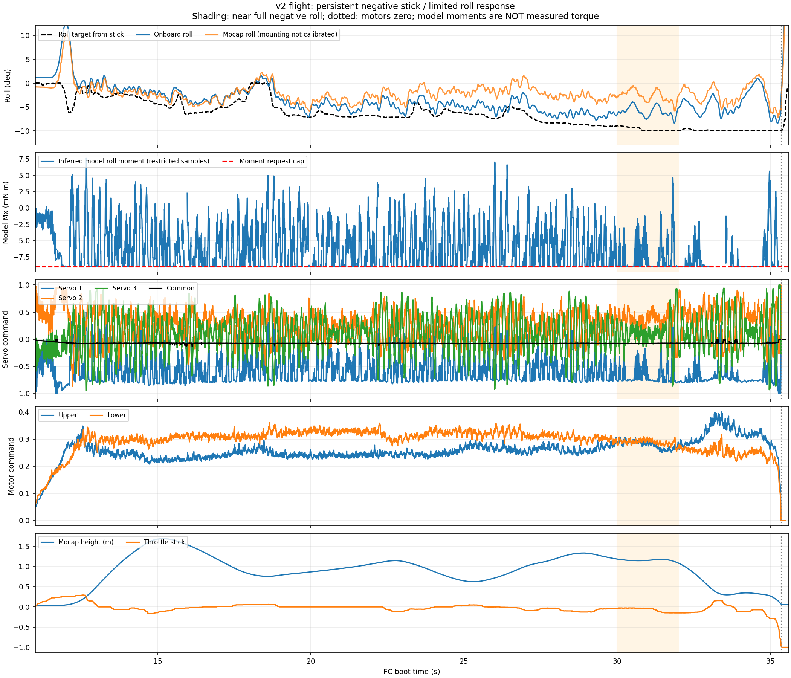
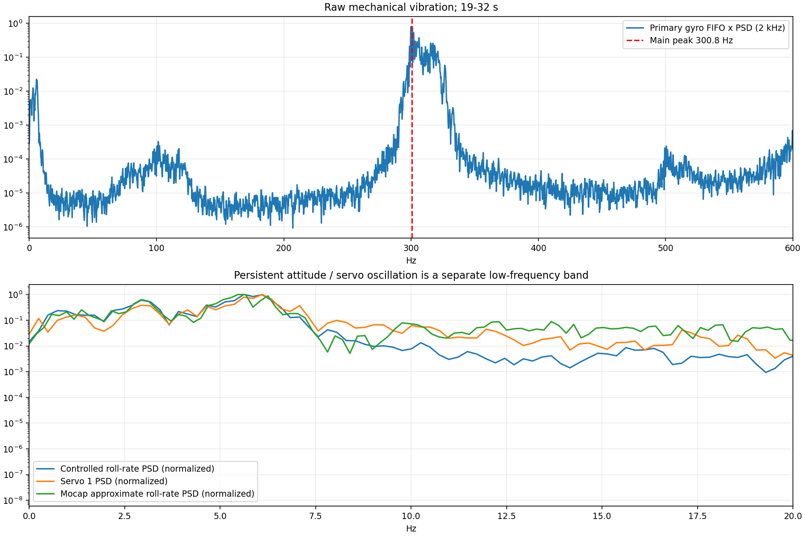

# 2026-11-05 第二架次：roll 偏置、跟踪不足与振动

源日志：`log/26.11.5/log_0_UnknownDate_1.ulg`。时间均为飞控上电后秒数。此次只做诊断和保存分析，未修改或刷写控制器。

## 后续澄清：右移不等于右滚

用户确认“向右”指动捕位置持续右移，而不是机体右侧低于左侧。因此不能由右移推断真实 roll 为正。本文的负 roll 数值是姿态角，与右向速度可以同时成立。

惯性可以使飞机左倾制动时仍向右滑。按动捕刚体航向定义的右向投影，27–30 s 平均右移速度约0.123 m/s，而平均右向加速度约−0.090 m/s²，说明该窗口已经在减小右移速度；这些导数由约1秒平滑估计，不能用于精确瞬时动力学辨识。

本机还存在格栅侧力—滚转耦合。模型格栅作用点在重心下方约0.05 m，侧向力对 roll 的贡献为 `Mx = -z*Fy`（FRD 中 +Fy 向右、+z 向下）；所以向右的侧力可同时产生负 roll 力矩。30–32 s 将记录的命令与 RPM 代入现有模型，也得到正的格栅横向力和负的格栅 roll 力矩。它是模型解释，不是力传感器实测。

因此，应把姿态跟踪不足、右向速度/加速度、格栅侧力和静态偏置分开分析，不能把“右移”直接作为 roll 符号反向的证据。先前对“往正方向顶”的解释没有充分说明这一点，现作补充。

## 主要结论

你描述的“负 roll 拉不动、总被往正方向顶”有明确的数据支持：30–32 s 飞手目标平均约 **−9.67°**，机载 roll 约 **−5.96°**，动捕约 **−2.67°**。空中大部分时间的绝对 roll 仍为负，但相对负杆目标存在持续正向误差；不是负杆没有进入控制器。

这次最直接的瓶颈是：**长期 roll 偏置需要负向补偿，v2 积分已经用满，比例项继续要求更多负力矩；约5–6 Hz 的真实小幅抖动又使速率反馈剧烈摆动，输出频繁受到 ±0.009 N·m 模型力矩限幅，平均负向纠偏不足。**

上一轮的有界积分和参考修正没有消除这些实机静态/动态不匹配。这次不能简单归因为 yaw 指令过大，也不应直接把积分上限或力矩上限继续加大。

此前检查到的 DIS 与解锁零指令不同，是 PX4 的正常语义。你已明确：设计采用端点中点作为零指令，没有把 DIS 当飞行中位。因此**排除“误把 DIS 当飞行中位”的解释，不据此改 trim**。

## 跟踪与限幅证据

| 时间 s | 目标 roll 均值 | 机载 roll 均值 | 动捕 roll 均值 | 负力矩限幅比例 |
|---|---:|---:|---:|---:|
| 19–22 | −6.74° | −4.88° | −3.67° | 约35% |
| 27–30 | −8.43° | −6.30° | −2.56° | 约31% |
| **30–32** | **−9.67°** | **−5.96°** | **−2.67°** | **约56%** |
| 32–33 | −9.81° | −5.09° | −2.33° | 约68% |

限幅比例仅统计满足当前分配关系、可反算模型请求的有效原生记录样本，不是实测气动力矩或精确墙钟占比。排除了共模扩展/退让、共模标度封顶和舵机端点处样本。

模型域反算使用：优先共模未退让/扩展且推力标度未封顶时，`common = −0.08 * servo_scale`，所以 `Mx = (servo1-common)*(-common/0.08)/72.0721436`。

后段 Servo1 软件输出约 −0.75，最低约 −0.81，并没有长期到 −1。说明首先遇到的是**力矩请求上限和有效纠偏不足**，不能直接等同于电控命令已经到舵机最小端点。没有舵角反馈，仍无法排除机械行程、负载下不到位或连杆等问题。

## v2 积分已经到边界，当前不是无限 windup

固定输入回放中，roll 积分力矩在大部分空中阶段保持约 **−0.0045 N·m**。用未限幅输出、当前姿态误差和角速度反算积分项，在多个窗口得到的中位数也约为 −0.0045 N·m。这支持 v2 的积分限制正在起作用。

回放并不精确：舵机输出 RMSE 约0.08–0.14，仍存在采样和时序误差；反算瞬时积分也有明显抖动。因此只用来支持“补偿达到边界”的判断，不把它当作机载内部积分 trace。

30–32 s，按当前增益和积分在边界的假设估计：

| 分量 | 模型域力矩 |
|---|---:|
| 姿态误差 P 项平均 | −0.00527 N·m |
| 速率反馈平均 | +0.00016 N·m |
| 速率反馈标准差 | **0.00398 N·m** |
| 积分项 | 约 −0.00450 N·m |
| 未裁剪请求平均 | 约 **−0.00962 N·m** |
| 裁到 ±0.009 后的平均 | 约 **−0.00761 N·m** |
| 从记录输出反算的平均 | 约 **−0.00750 N·m** |

也就是说，在持续负向补偿的工作点，振荡中的负向请求很容易被截住，而反向摆动仍会把输出拉回。约半个力矩上限量级的速率反馈波动，占用了相当多的动态余量。这能解释为什么杆量继续加负，平均纠偏却增加有限。

速率反馈对应真实运动的成分很多，不能把它全部当传感器噪声直接删掉。单纯增加积分，会重新挤占制动/纠偏余量；单纯提高力矩上限，可能放大当前抖动。

## 振动有两个不同频段

### 约300 Hz：强烈的原始机械/转速相关振动

主 BMI088 gyro FIFO 为每批2样本、dt=500 us，19–32 s 样本连续性很好，最大相邻间隔约556 us。基于这路接近2 kHz的原始采样，x轴主峰约 **300.8 Hz**，附近300–325 Hz能量很强。

该窗口上下桨机械 RPM 中位数约9178/9314，对应每转频率约153/155 Hz。强峰接近转速二阶谐波的量级，值得检查桨叶、桨毂、轴系、连接和 IMU 安装；不能单凭这一谱线唯一认定哪片桨失衡。

500 Hz 记录的 `sensor_gyro` 会出现约198 Hz的混叠峰，不能拿那个峰直接认定原始振动频率。副 BMI270 原始 FIFO 在日志中并非完整1600 Hz采样，不把它的插值频谱作为主要定量依据。

### 约5–6 Hz：真实的姿态/执行器闭环抖动

处理后的机体 roll 角速度主峰约 **5.62 Hz**，Servo1 输出也在这一频段有明显峰。将动捕 roll 微分得到近似 roll 角速度，其主峰约 **5.47 Hz**，与机载 roll 角速度在附近的相干度约 **0.96**。

这支持它是实际机体抖动，而不是一枚陀螺独自报出虚假角速度。闭环相关性本身不能判定是舵机响应、外扰、结构耦合还是控制增益首先激起振动。

19–32 s，处理后的 roll 角速度标准差约0.251 rad/s；约23%的样本绝对值超过0.3 rad/s。当前速率增益约0.01686 N·m/(rad/s)，所以这部分波动会产生与限幅余量相当的力矩请求。

## 为什么要重点检查执行器动态和实际效能

日志中 `PWM_MAIN_TIM1=50`、`PWM_MAIN_TIM2=50`。板级映射将 M6 放在 timer group1，M7/M8 放在 group2，故三舵机配置的 PWM 更新率为 **50 Hz**。

控制核心以2 ms模型步长设计，而50 Hz输出会引入约20 ms采样保持周期，再叠加舵机、连杆、气动响应和传感器滤波。8状态姿态 LQI 按请求力矩设计，没有把这些实际执行器状态完整纳入闭环设计。此前 v2 三轴自建验证包含了舵机一阶近似，但未加入真实50 Hz PWM采样保持，也没有实机效能辨识，不能据此验证5–6 Hz处的稳定裕度。

持续需要负 roll 补偿，还表明机架需要一个静态反向力矩：可能涉及重心/推力作用线、格栅气动力不对称、连杆/舵角映射、共模产生的寄生 roll 或估计/安装外参偏差。现有日志没有实际舵角和实测力矩，不能唯一识别这些因素，更不能由持续偏置直接宣布某个舵机反向。

机载与动捕 roll 存在数度差异，其差值在飞行过程中也有变化；未完成固定安装外参标定前，不能将所有差异精确归因于 IMU 漂移。但它会影响飞手对真实倾角和控制跟踪误差的判断，需要一起核对。

## PWM 中位语义已澄清

PX4 输出映射是将 `[−1,1]` 线性映射到 `[MIN,MAX]`，解锁零指令确实取两端中点。当前值：

| 输出 | 功能 | 解锁零指令 PWM | DIS |
|---|---|---:|---:|
| M6 | Servo3 | 1470 us | 1500 us |
| M7 | Servo2 | 1550 us | 1500 us |
| M8 | Servo1 | 1545 us | 1450 us |

DIS 只用于停机/无效输出等状态。用户确认当前设计采用端点中点作为零指令，故这些差异本身不是参数错误。本次没有根据 DIS 推算或写入任何新的 `NN_SV_TRIM`。

## 末尾翻倒的时序

- 35.329 s，油门降到约 −0.861。
- **35.352 s，电机输出归零。**
- 35.437 s，机载 roll 首次超过 +10°；35.508 s 超过 +30°。
- 35.510 s，30°姿态保护触发。

末尾明显的正向翻倒发生在低高度、切油门之后，不能反过来当成整个空中阶段 roll 方向反了的证据。空中阶段应重点看“负杆目标与实际倾角之间的正向误差”和持续抖动。

## 下一步优先级

1. 不继续扩大 yaw 共模或放松转速边界来处理 roll；当前 roll 症状需要独立解决。
2. 在桨流/受控台架下核对零差模和小差模的实际格栅响应、roll 正反向效能与静态补偿量；把静态配平与动态姿态反馈分开辨识，不靠飞手长时间负杆和受限积分补足。
3. 在包含50 Hz保持、执行器滞后及真实效能的模型上重新检查 roll/pitch 速率反馈和闭环带宽，先抑制5–6 Hz抖动，再评估需要的力矩/舵量范围。不要只因软件输出没到−1就直接提高力矩上限。
4. 处理约300 Hz的转速相关机械振动；滤波只能辅助，不能替代机械检查。两枚 gyro 与动捕已有真实运动旁证，不建议再次只靠换 IMU 解释全部问题。
5. 补录内部未裁剪/已裁剪力矩、积分、共模、分配残差和实测 PWM/舵角，以减少下一轮仅靠反算的歧义。

## 数据质量与复现

本次 ULog 没有记录 dropout。动捕3387帧全部 fresh，最大 pose_age约9.66 ms；机载四元数和飞控时间戳与地面会话 `flight_20261105T061135_138Z_aircraft-01_3` 对齐。主IMU仍为BMI088，副IMU削顶告警不能直接等同于主估计器异常。零丢帧不代表所有原生传感器样本均被保存。

解析：`python3 parse_ulog.py`；近似回放：`python3 replay.py`；分析绘图：`/home/ryan/miniconda3/envs/rl-flight/bin/python analyze.py`。v2源码快照在 `controller_v2_source`，结果在 `metrics.json`、`timeline.csv`、`replay_metrics.json` 和两张图中。
