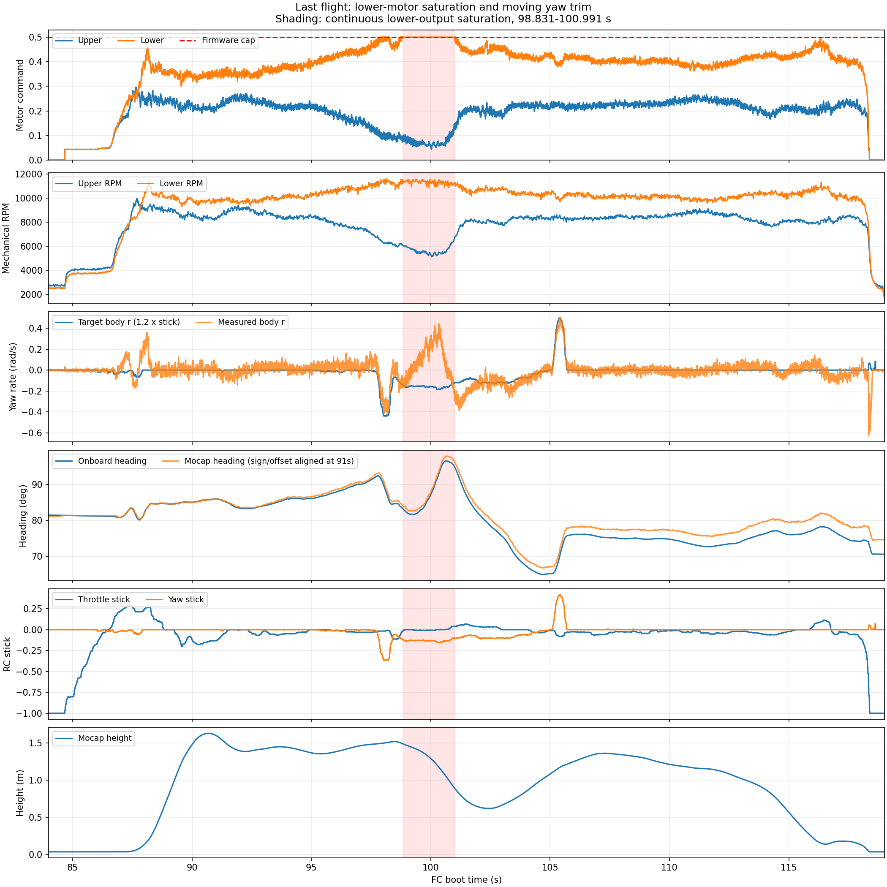
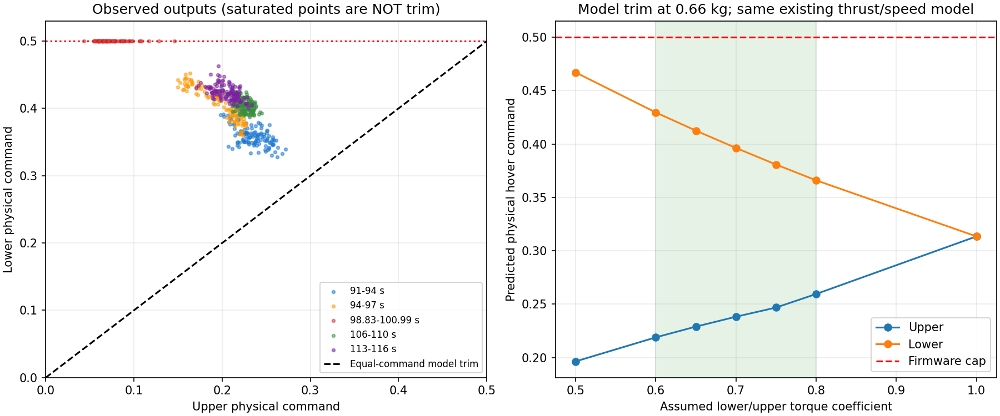

# 2026-11-04 最后一次飞行 yaw 饱和与配平分析

源日志：`log/26.11.4/log_0_UnknownDate_1.ulg`。时间均为飞控启动后秒数。只新增离线分析文件，未改控制器、配置或固件。

## 结论

确有下桨软件限幅引起的单向 yaw 权限不足。最严重的连续饱和位于 **98.831–100.991 s，约 2.165 s**，不是最后落地前才出现。最后一次有效电机运行约为 84.677–118.371 s；之后下桨曾恢复到约 0.40，116 s 附近再次接近上限。

实际零 yaw 工作点明显偏离当前模型的等输出配平。修改配平前馈值得做，但它主要减少稳态积分负担和起飞过渡误差，不能凭空增加力矩余量。单独降低 yaw 指令不能解决本日志暴露的全部问题，因为 yaw 杆基本居中时，差速偏置就已明显增长。更完整的处理是：校正上下桨配平及局部效能、保留可回退的积分补偿、按可用余量限制 yaw 分配，并在该基础上降低转向指令及其变化速度。

## 证据与时序

以下输出均为 `actuator_motors.control`，已经过最终乘 0.5 映射。上限 0.5 是当前固件软件上限，不是证明电机已经达到硬件最大转速。内部控制域范围为 0–1。

| 时段 s | 上桨输出中位数 | 下桨输出中位数 | yaw 目标均值 rad/s | 实际 r 均值 rad/s | 解释 |
|---|---:|---:|---:|---:|---|
| 91–94 | 0.235 | 0.357 | -0.0005 | +0.0008 | 可用的近零 yaw 工作点 |
| 94–96 | 0.213 | 0.393 | -0.0038 | +0.0169 | 杆接近居中，差速偏置已经增长 |
| 96–97 | 0.167 | 0.435 | -0.0068 | +0.0408 | 尚未强烈转向，已接近单向余量边界 |
| 97–98 | 0.132 | 0.462 | -0.0617 | +0.0048 | 出现零星触顶，负向目标跟踪不足 |
| 98.831–100.991 | 0.070 | **0.500** | **-0.158** | **+0.098** | 下桨连续饱和，平均实际转动方向与目标相反 |
| 106–110 | 0.225 | 0.404 | +0.0003 | -0.0034 | 恢复到另一近零 yaw 工作点 |
| 110–113 | 0.242 | 0.389 | 0 | -0.0018 | 有效零 yaw 工作点仍明显不对称 |
| 113–116 | 0.206 | 0.423 | 0 | +0.0193 | 无 yaw 指令，下桨需求再次增长 |
| 116–117 | 0.207 | 0.457 | 0 | -0.0126 | 瞬时最高约 0.498，接近上限但未持续贴顶 |

98.831–100.991 s 机载航向累计偏移约 +11.8°，yaw 角速度误差 RMS 约 0.304 rad/s。下桨机械转速约 11335 RPM，上桨约 5512 RPM。ESC 通道功能 101/102 对应上下桨，两路始终 online，所记录 failures/errorcount 为零。电压和电流记录均为零/不可用，不能据此排除供电压降。

该连续饱和窗口的动捕 z 从约 1.49 m 降至 0.90 m，说明同时发生了明显掉高；没有内部推力 trace，不能把全部掉高唯一归因于限幅。113 s 之后则已经进入下降过程，116–117 s 动捕 z 约 0.23–0.18 m：这一末尾近地窗口可能受地效、着陆及接触影响，不应把它当成自由悬停配平样本。配平候选主要依据 91–94 s 和 106–113 s 的空中近零 yaw 阶段。

找到了对应地面站会话 `flight_20261104T114002_007Z_aircraft-01_43`，用 message 19 的飞控启动时间和四元数交叉匹配：四元数绝对点积最小约 0.999996。动捕 sequence 持续更新，相关窗口 pose_fresh=100%，最大 pose_age 约 9.74 ms。饱和窗口动捕 z 均值约 1.27 m，航向变化约 -12.3°，与机载航向变动大小接近、坐标符号相反。因此不能把本次现象简单解释为落地摩擦或机载航向虚漂。动捕安装外参未重新标定，图中只对航向做符号与常数偏移对齐，不把绝对欧拉角当作同一坐标系的精密真值。

## 平衡点位置与系数含义

当前配置给上下桨相同的命令—转速表，以及相同的反扭矩系数 `2.30e-8`。下桨转速曲线是复用上桨标定，配置注释明确说明并非下桨独立实测。

核心在 `LqiCoaxialCollectiveCore.hpp:279` 使用

`omega_lower / omega_upper = sqrt(kQ_upper / kQ_lower)`

计算基础配平。按当前 0.66 kg、既有推力模型和转速表，悬停基础输出为 **0.3134/0.3134**，目标转速约各 9578 RPM；与日志中的零 yaw 工作点不符。

106–110 s 的实际转速约为 **8375/10132 RPM**；如果把该窗口近似为无外扰的稳态反扭矩平衡，则表观比值

`kQ_lower/kQ_upper ≈ (RPM_upper/RPM_lower)^2 ≈ 0.686`。

91–94 s 得到约 0.790，110–113 s 约 0.764，113–116 s 约 0.603。**这支持“下桨需要更高转速”的工作点特征，但不能从闭环日志唯一辨识真实气动系数。**旋翼干扰、局部气流、转速曲线误差、舵面寄生力矩、外扰和非稳态都可能进入这个表观比值。不能把饱和时的 0.237 当成有效配平系数；该窗口实际偏航明显，平衡条件不成立。

只改变 kQ 比值、保持现有其他模型不变，计算出的悬停点如下。它是参数敏感性研究，不是已验证的新参数：

| 假设 kQ下/kQ上 | 上桨基础输出 | 下桨基础输出 | 下桨到 0.5 的输出余量 |
|---:|---:|---:|---:|
| 1.00，当前 | 0.3134 | 0.3134 | 0.1866 |
| 0.80 | 0.2595 | 0.3659 | 0.1341 |
| 0.75 | 0.2468 | 0.3807 | 0.1193 |
| **0.70** | **0.2382** | **0.3963** | **0.1037** |
| 0.65 | 0.2289 | 0.4125 | 0.0875 |
| 0.60 | 0.2189 | 0.4295 | 0.0705 |
| 0.50 | 0.1964 | 0.4670 | 0.0330 |

比值 0.7 产生的工作点与部分稳定飞行阶段相近，可作为离线/台架辨识的初始候选。没有依据把 0.7 作为所有工况下固定准确的系数。工作点还应随总推力变化，而不是固定加一个下桨 PWM 常数。

## 修改配平能改善什么

可以减少控制器用 yaw 积分去补偿长期模型误差的负担，减少起飞时寻找零力矩点的过程，并让后续效能矩阵和余量判断围绕更真实的工作点展开。

但如果当前控制器已经靠积分实现 0.23/0.40，把前馈也改成这一点后，正确稳态应是前馈承担更多、积分承担更少，最终所需转速基本不变；下桨余量不会因此从 0.10 自动增加到 0.19。若保留原积分值并突然叠加新配平，反而可能瞬时过补偿，切换必须重置或平滑迁移偏置。

本日志还显示，在 yaw 杆近零时，工作点从 91–94 s 的约 0.235/0.357 向 96–97 s 的约 0.167/0.435 演化，恢复后又在 113–117 s 出现类似趋势。固定配平只能解决平均偏差，不能解释或消除全部变化。下一步应测多个总推力和差速比下的下桨转速及 yaw 响应，确认是否需要随工况变化的配平表或有界在线偏置估计。

若通过修改反扭矩系数实施，需同步重新生成配平、yaw 效能矩阵和相关 LQI 设计并验证；只改基础输出而继续沿用对称 yaw 分配，会留下明显模型不一致。单条日志不足以确定 kQ 绝对值和惯量，因此不要仅凭表观比值宣称完成了气动辨识。

## 限幅 yaw 指令能改善什么

当前参考适配器是 `r_target = rc_yaw * 1.2 rad/s`，没有参考一阶滞后。要区分两种改法：

1. **将满杆比例 1.2 改成 0.6 rad/s**：同样杆量的转向要求减半，可以减少转向瞬间的额外差速需求，值得作为配套措施。
2. **仍用 1.2 倍杆量，只把最终目标硬裁到 ±0.3 rad/s**：连续饱和窗口目标约 -0.158 rad/s，绝大多数本来就在此范围内，对该窗口几乎不起作用。

用当前生成模型的 yaw 速率增益 `Kr=0.0193105` 和悬停附近效能斜率，在固定实测状态及积分的条件下估算比例调整的即时作用：

`Δlower ≈ -Kr * Δr_target / (4*b_yaw)`。

从满杆 1.2 降到 0.6 rad/s，该连续饱和窗口的下桨原始需求平均仅减少约 **0.016**；降至 0.3 时约减少 **0.024**。与长期配平偏差相比不大，而且触顶日志隐藏了超限的原始需求。该估算不等于改参数后的闭环飞行回放，也无法证明调整后一定脱离饱和。长期积分轨迹会改变，需要辨识后闭环仿真验证。

此外，113–117 s 的 yaw 杆为零，缩小杆量比例对此阶段的直接作用为零。因此**单独限 yaw 指令不能覆盖本次全部现象**。建议把 0.6 rad/s 作为初始验证候选，同时研究目标角加速度限制；具体可接受速度/加速度需要根据实测余量和响应确定，不能用单条日志保证。

## 分配与抗饱和比单纯限杆更关键

现有核心先求共模/差模，再分别把两路电机裁到 0–1（输出映射后 0–0.5）。一路饱和后，原先要求的总推力和 yaw 力矩通常不能同时实现。较可靠的做法是在裁剪前按基础配平和局部效能计算可行的 yaw 力矩区间；在保总推力优先的分配中缩小差速量，并把真实实现的力矩残差反馈给 yaw 积分。

同样的硬件与工况下，该处理可以避免提出无法实现的指令、改善恢复行为，仍不能保证保高度与保航向在物理不可行时同时成立。需要明确饱和时的分配优先级。

当前已经有抗积分饱和：任一电机或舵机饱和时，姿态积分整体冻结；电机饱和时垂向加速度积分也冻结。故不能简单定性为“触顶后积分继续无限增加”。但冻结也会禁止有助于退出饱和的反向积分更新，且外层力矩裁剪本身未进入该饱和判据。建议改成按轴、按方向允许积分回退，或用实际分配残差反算；不建议直接删除 yaw 积分，因为模型误差和外扰仍需补偿。

在相同推力需求下，如果真实的零 yaw 点已接近下桨 0.5，上述软件措施都不能创造更多持续反扭矩。此时需要降低总推力/载荷要求，或改善下桨、电机、供电及桨叶匹配。不要仅把最终输出缩放从 0.5 调大：该缩放与已有转速标定和控制模型绑定，修改它需要重新标定与验证。

## 数据和推断边界

- 日志全长约 261.8 s，真正最后一架次在前述 84.7–118.4 s；后半文件有大量停机数据，不能把文件结尾当飞行结尾。
- 全日志记录 24 次 dropout，共约 1.320 s；最后一架次角速度样本最大间隔约 7.10 ms。四元数模长与 topic 时间戳单调性检查通过。
- 日志参数 `NN_LQI_MODEL=2`。本分析参考当前仓库 manual-v3 核心与生成 payload，其上限和输出模式与实测相符；ULog 未记录飞行时 payload checksum，不能声称逐字节认证飞行镜像等于当前源码。
- 机载没有记录内部配平值、原始未裁剪电机请求、yaw 积分与力矩残差。因此不能给出“积分风up”“某气动系数变化”或“改限幅后一定解决”的唯一因果结论。
- 建议后续补录：upper/lower base、raw motors、实际饱和标志、yaw 参考/误差/积分、请求/实现 yaw 力矩、总推力、模型 checksum 与有效电池电压。

复现：先用 `python3 parse_ulog.py` 解析，再用 `/home/ryan/miniconda3/envs/rl-flight/bin/python analyze.py` 分析。输出为 `metrics.json`、`windows.csv`、`timeline.csv` 与两张图。
